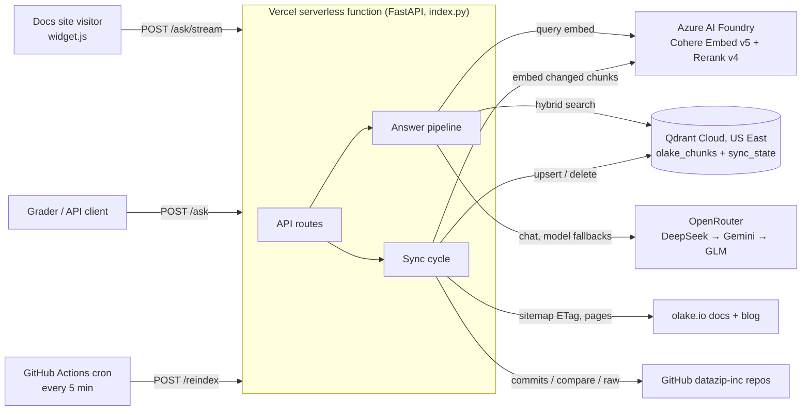

# Ask OLake

A production-grade RAG assistant for the [OLake](https://olake.io/docs/) docs. It answers questions about OLake ingestion and OLake Fusion with exact source links, says plainly when the docs don't cover something, and keeps itself fresh by re-indexing changed content every 60 seconds.

- **Endpoint:** `POST /ask` → `{"answer": "...", "sources": ["<url>", ...]}`
- **Demo page with the embedded widget:** `/demo` (also `/`)
- **Freshness and index stats:** `/status`
- **Live commit and deployment:** `/version` → `{"commit": "<VERCEL_GIT_COMMIT_SHA>", "deployment": "<VERCEL_DEPLOYMENT_ID>"}`
- **OpenRouter models this key can use:** `/models` (fetched live from OpenRouter's `/models/user`)
- **Interactive API docs:** `/docs`
- **MCP server (admin key, container/local mode):** `/mcp`

## Quick start

```bash
curl -s -X POST https://<your-host>/ask \
  -H 'Content-Type: application/json' \
  -d '{"question": "What do I need to set up Postgres CDC?"}'
```

```json
{
  "answer": "OLake uses the native pgoutput plugin ... set wal_level = logical ... [1][2]",
  "sources": ["https://olake.io/docs/connectors/postgres/setup/generic/", "https://olake.io/docs/connectors/postgres/#cdc-prerequisite"]
}
```

`[n]` in the answer refers to `sources[n-1]`. The body always has exactly these two keys, including on errors (422, 429, 503, 504). Debug data goes in headers: `X-Model` (the LLM that answered), `X-Cache`, `X-Top-Score`, `X-Refusal`, `X-Request-ID`, `X-Response-Time-ms`.

### Embed the chat widget (one line)

```html
<script src="https://<your-host>/widget.js" data-api-url="https://<your-host>"
        data-position="bottom-right" data-theme="auto" defer></script>
```

For Docusaurus, add it to `docusaurus.config.js`:

```js
scripts: [{ src: 'https://<your-host>/widget.js', defer: true, 'data-api-url': 'https://<your-host>' }],
```

The widget is a single vanilla web component (`<ask-olake>`, about 30 KB, no dependencies) isolated in Shadow DOM. It streams answers over SSE, falls back to `/ask` if streaming fails, renders a safe markdown subset (no `innerHTML` from the model), shows numbered sources and **which model answered each reply**, has light, dark and auto themes, goes full-screen on mobile, and is fully keyboard-accessible.

## Architecture

### Deployment



The same code also runs as a long-lived container (`docker compose up`): there, a background asyncio poller drives the sync every 60 s and the MCP server is mounted at `/mcp`.

### Sync and answer flow

```mermaid
flowchart LR
  subgraph Sync["Sync (every 60 s, one asyncio task)"]
    SM[olake.io sitemap<br/>ETag / lastmod] --> CR[Crawl changed pages<br/>docs + blog]
    GH[GitHub commits API<br/>ETag, compare] --> RL[Changed repo files<br/>olake, olake-ui, olake-helm, olake-fusion]
    CR --> CH[Heading-aware chunker<br/>deterministic IDs + hashes]
    RL --> CH
    CH --> EM[Embed changed chunks only<br/>Cohere Embed v5 + BM25]
    EM --> QD[(Qdrant Cloud<br/>dense + sparse)]
    EM --> INV[Targeted cache invalidation]
  end
  subgraph Ask["POST /ask"]
    Q[Question] --> G{Guards} --> C{Cache} --> H[Hybrid search<br/>dense + BM25, RRF]
    H --> QD
    H --> RR[Cohere Rerank v4 Pro<br/>Fast fallback] --> GATE{Score ≥ threshold?}
    GATE -- no --> REF[Refusal, sources = []]
    GATE -- yes --> LLM[OpenRouter LLM<br/>DeepSeek V4.1 Flash → Gemini 2.5 Flash Lite → GLM 4.7 Flash] --> PP[Citation mapping<br/>link and leak checks] --> A[answer + sources]
  end
```

### Project layout

```
app/
  main.py            FastAPI app, routes, error contract, CORS, static widget
  runtime.py         lazy, idempotent wiring of clients (serverless-safe)
  config.py          every setting from environment variables (pydantic-settings)
  api/               ask.py (/ask, /ask/stream, /ask/debug), status.py (/status, /health), admin.py (/reindex),
                     meta.py (/version, /models)
  ingest/            docs_crawler.py (sitemap + rendered HTML → sections), repo_loader.py (include rules,
                     GitHub API, clones), chunker.py (heading-aware chunks, IDs, hashes), classify.py, indexer.py
  sync/              poller.py (incremental/full cycles, per-source isolation), state.py (state in Qdrant)
  retrieval/         embeddings.py (Cohere + BM25, TPM budget), search.py (hybrid RRF + boost),
                     rerank.py (Pro → Fast), pipeline.py (gate, prompt, citations, guardrails)
  llm/               client.py (OpenRouter, fallbacks, cost guard, streaming), prompts.py
  cache.py           TTL answer cache + chunk→answer reverse index for targeted eviction
  security.py        rate limiting, admin auth;  observability.py  JSON logs, request IDs, timings
  mcp_server.py      ask_olake / search_docs MCP tools (container mode)
widget/              ask-olake.js (Shadow DOM web component), demo.html
eval/                olake_testcases.jsonl (official 20), questions.jsonl (30), run_eval.py
scripts/full_index.py  one-off full index into Qdrant
models/              bundled BM25 + tiktoken files (no downloads on cold start)
tests/               chunker, cache invalidation, citation post-processing, /ask contract
index.py             Vercel entry point;  Dockerfile / docker-compose.yml for container runs
```

## Design decisions

| Decision | Why |
| --- | --- |
| **Crawl the rendered site, not the MDX** | The docs import shared MDX partials and JSX components, so the raw files are incomplete. Rendered HTML gives the exact public URLs (with the trailing slash) and real heading anchors, so every citation resolves. |
| **Heading-aware chunks** (split on h2/h3, including headings inside UI/CLI tabs; 80–500 tokens; code blocks and tables never split; breadcrumb prefix) | One chunk per section gives precise anchor citations. The breadcrumb (`Sources > Postgres > CDC Prerequisite`) adds context to the embedding. |
| **Deterministic IDs** (`uuid5(url, heading path, part)`) **and content hashes** | Re-indexing is idempotent. A sync re-embeds only chunks whose hash changed and deletes IDs that disappeared. |
| **Qdrant hybrid search** (dense + BM25 with IDF, fused server-side with RRF in one Query API call) | Dense vectors catch meaning; BM25 catches exact terms like `pgoutput`, `binlog_row_image` or error strings. Writes are searchable immediately (`wait=true`), which the 60 s freshness relies on. |
| **Cohere Embed v5 (1024-d) and Rerank v4 Pro on Azure** | High retrieval quality. Rerank scores separate answerable from unanswerable questions well (≥ 0.93 vs ≤ 0.81 on our eval), which drives the honesty gate. Fast is the reranker fallback, then RRF order. |
| **Soft filter boost** | If the question names a connector or product, an extra filtered prefetch joins the fusion. It never hard-filters, so general pages still match. |
| **Honesty gate + grounded prompt** | If the top rerank score is below `REFUSAL_THRESHOLD`, no LLM call is made. Otherwise the LLM must cite every fact with `[n]`. `sources` is the cited blocks in first-cited order, plus the best-ranked section if the model cited a weaker duplicate of it. If the model answers without any markers, the top retrieved sections are cited instead of discarding a grounded answer. |
| **"Not supported" vs "couldn't find"** | The docs-home "Supported Sources" and "Destinations" sections are always in context, so "Can OLake write to Delta Lake?" gets a cited "not supported, here is what is". Facts missing from the docs (SLAs, pricing) get "I couldn't find this in the OLake documentation" and a pointer to the community Slack. |
| **LLM: OpenRouter, DeepSeek V4.1 Flash first, then Gemini 2.5 Flash Lite and GLM 4.7 Flash as server-side fallbacks** | All three allowed models were benchmarked on the same grounded prompt: DeepSeek was the fastest (~0.65 s for a typical answer) and the most complete and best-cited; on the official 20 cases it scored 95% vs 90% with GLM first. Gemini Flash Lite is the fast, cheap first fallback and GLM the last. The list is sent as OpenRouter's `models` fallback field so a failing model falls through in one request. Reasoning is off, temperature is 0.1 and answers are capped at 900 tokens (a reply cut off almost empty is retried once on the next model). The model that answered is returned in `X-Model` and shown in the widget. A credit guard switches to the cheapest model under $1 left and stops LLM calls under $0.10. |
| **Docs over blog** | Blog posts are indexed (graders cite them) but get a small rank penalty and at most 2 blocks per answer, since they can be older than the docs. |
| **olake-fusion repo filtered** | Fusion is a fork of Apache Amoro. Upstream docs for features Fusion doesn't ship (Flink, Paimon, mixed-Hive, Kyuubi) are excluded so the bot can't confidently describe them. |
| **Two run modes, one codebase** | In a container (Docker Compose) one worker runs the background poller and holds the cache. On Vercel (serverless, detected from the `VERCEL` env var) clients are built lazily on the first request, the index is prebuilt in Qdrant Cloud, and freshness comes from on-request lazy syncs plus a cron calling `/reindex`. |
| **Small serverless bundle** | No torch or local embedding models: embeddings and rerank are API calls, and BM25 runs through FastEmbed's ONNX runtime. The BM25 model and the tiktoken encoding are committed under `models/` (1.8 MB), so cold starts never download anything. |

## Freshness

- **Docs and blog:** `sitemap.xml` is fetched with `If-None-Match`, so an unchanged site costs one `304`. Changed `lastmod` → re-fetch the page → compare the page hash → upsert changed chunks and delete stale ones. URLs removed from the sitemap are deleted. Pages without `lastmod` are re-checked every 5th cycle.
- **Repos:** `GET /commits/{branch}` with an ETag (304 when unchanged). On a new SHA, the compare API lists changed files; added and modified files are fetched raw at that SHA and re-chunked, removed and renamed files are deleted. A failed compare, or one with 300+ files, falls back to a fresh shallow clone plus a chunk-hash diff.
- **Cache:** answers are cached for an hour, keyed by the normalised question. A sync evicts only the answers that used a changed or deleted chunk, answers whose question embedding is ≥ 0.75 cosine-similar to a new chunk, and all cached refusals (new content may now answer them). A sync with no changes evicts nothing.
- **State:** poller state (SHAs, ETags, per-page hashes) lives in a small Qdrant collection, so a restart resumes where it left off. Changing the embedding model forces a full re-index.
- **On Vercel (serverless):** there is no always-on process, so freshness comes from two places. When `/ask`, `/ask/stream` or `/status` is hit and the last cycle is older than `POLL_INTERVAL_SECONDS`, an incremental cycle starts in the background. A GitHub Actions cron (`.github/workflows/sync.yml`, every 5 minutes) also calls `POST /reindex` with `{"scope": "incremental"}`, which runs the cycle inline (typically about 1 s when nothing changed). Full re-indexes run locally with `python -m scripts.full_index`.
- **Check it:** `/status` shows `last_poll`, `last_change_detected`, the indexed SHA, chunk and page counts per source, cache stats and the LLM credit left. `POST /reindex` (with an `X-Admin-Key` header) accepts `{"scope": "incremental" | "full"}`.

## Production readiness and guardrails

- **Input:** 1–1,000 characters, control characters stripped, unknown JSON fields ignored. Prompt-injection and "reveal your prompt" requests are refused before any LLM call.
- **Output:**
  - Citations are mapped to real blocks.
  - Links not in the context, or not on `olake.io` or `github.com/datazip-inc`, are stripped.
  - Answers that echo the system prompt or look like an API key are replaced with a refusal.
  - Off-topic requests (poems, trivia) are politely redirected to OLake.
- **Limits:** `slowapi` per-IP limits (default 120/minute, 5000/day, client IP from `X-Forwarded-For`) return 429 with `Retry-After` and the contract body. At most 8 concurrent LLM calls. Bulk embedding stays under the provider's tokens-per-minute budget.
- **Timeouts and fallbacks:**
  - Embedding 20 s (bulk) with at most 2 tries per query, rerank 8 s, Qdrant 10 s, LLM 20 s with at most 1 retry, whole request 25 s (graders score answers within 30 s).
  - Retries use exponential backoff with jitter and respect `Retry-After`.
  - If rerank fails, RRF order is used. If the LLM fails, other models are tried, then the endpoint returns 503.
  - A failing source never stops the others from syncing.
- **Observability:** structlog JSON logs with request IDs and per-stage timings, `/health` (503 until the index is ready), and FastAPI OpenAPI at `/docs`.
- **Secrets** come only from environment variables. `.env` is git-ignored, and `.env.example` has no values.

## Evaluation

- `eval/olake_testcases.jsonl`: the organisers' 20 test cases.
- `eval/questions.jsonl`: 30 hand-written questions (setup, connectors, sync modes, catalogs, Fusion, Helm, troubleshooting, out-of-scope, injection).

```bash
python eval/run_eval.py --base-url https://<your-host> --file eval/olake_testcases.jsonl --check-urls
```

The runner checks the exact contract shape, refusal behaviour, page-level source hits, key-fact coverage and p50/p95 latency, and prints rerank top scores to help tune `REFUSAL_THRESHOLD`.

Latest local runs (development machine in India; the services are in US East):

| Set | Primary model | Pass | Contract | Refusals correct | Source hit | Key facts | p50 / p95 latency |
| --- | --- | --- | --- | --- | --- | --- | --- |
| Official 20 | GLM 4.7 Flash | 90% | 100% | 100% | 88% | 87% | 4.0 s / 6.8 s |
| Official 20 | DeepSeek V4.1 Flash | 95% | 100% | 100% | 94% | 98% | 4.4 s / 6.6 s |
| Own 30 | DeepSeek V4.1 Flash | 97% | 100% | 100% | 96% | 97% | 4.7 s / 8.1 s |

Cost: about 3–4k input and 300–600 output tokens per answer, roughly $0.0005–0.002 per question, so about $0.5–2 per 1,000 questions before cache hits.

## Local development

```bash
cp .env.example .env            # fill in the keys
docker compose up --build       # app on :7860 + local Qdrant on :6333
# or, without Docker:
python -m venv .venv && .venv/bin/pip install -r requirements-dev.txt
.venv/bin/uvicorn app.main:app --port 7860 --workers 1
.venv/bin/pytest -q
```

The first start runs a full index (about 5 minutes, throttled to the embedding provider's rate limit). After that the poller keeps the index fresh.

**Deploy (Vercel, from GitHub):**
1. Build the index once locally: `python -m scripts.full_index`. It goes into Qdrant Cloud, which the deployment reads.
2. Import the GitHub repo in Vercel (Add New → Project). `index.py` exposes the FastAPI `app`, so Vercel detects it with no extra config.
3. Add the variables from `.env.example` under Settings → Environment Variables, and tick **Enable access to System Environment Variables** so `/version` gets `VERCEL_GIT_COMMIT_SHA` and `VERCEL_DEPLOYMENT_ID`.
4. Every push to `main` redeploys.
5. For the sync cron, add the repo secrets `ASK_OLAKE_URL` (your Vercel URL) and `ADMIN_KEY`.

The Dockerfile still runs anywhere Docker does (it listens on `$PORT`).

## Configuration

Everything is set through environment variables (`app/config.py`); see `.env.example` for the full list. The main ones:

| Variable | Default | Purpose |
| --- | --- | --- |
| `OPENROUTER_API_KEY`, `LLM_MODEL`, `LLM_FALLBACK_MODELS` | DeepSeek V4.1 Flash, then Gemini 2.5 Flash Lite and GLM 4.7 Flash | LLM and fallbacks |
| `EMBED_ENDPOINT`, `EMBED_API_KEY`, `EMBED_MODEL`, `EMBED_DIM` | Cohere-Embed-V5-Pro, 1024 | Dense embeddings |
| `RERANK_*`, `RERANK_FALLBACK_*` | Cohere-rerank-v4.0-pro / fast | Reranking |
| `QDRANT_URL`, `QDRANT_API_KEY` | — | Vector DB |
| `GITHUB_TOKEN`, `REPOS` | 4 OLake repos | Repo sync |
| `DOCS_PATH_PREFIX` | `/docs/,/blog/` | Which site sections to index |
| `POLL_INTERVAL_SECONDS` | 60 | Freshness |
| `REFUSAL_THRESHOLD` | 0.35 | Honesty gate on the rerank score |
| `RATE_LIMIT` | `120/minute;5000/day` | Per-IP limit |
| `ADMIN_KEY` | — | `/reindex`, `/ask/debug`, `/mcp` |

## Limitations and next steps

- Single-turn: each question is answered on its own.
- Sitemap and commit polling every 60 s; webhooks would make updates instant.
- The cache lives in process memory and is lost on restart (by design, for a single process).
- Feedback buttons in the widget and an answer-quality dashboard would close the loop.
